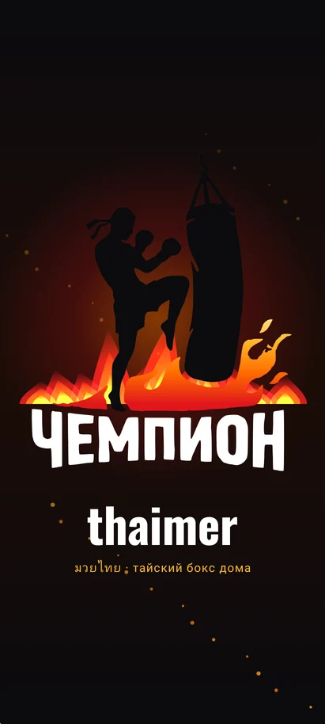
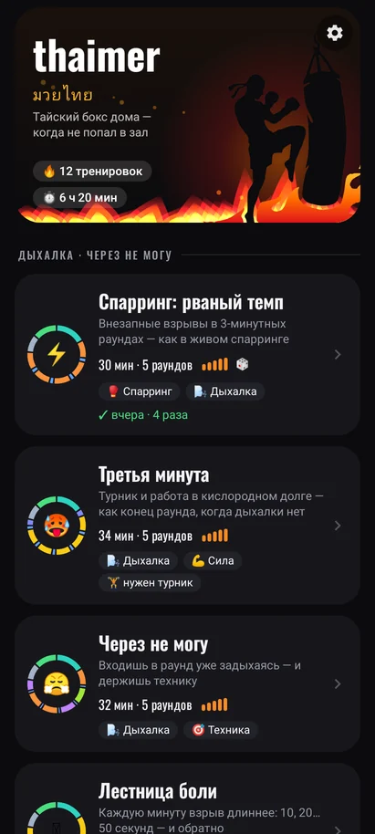
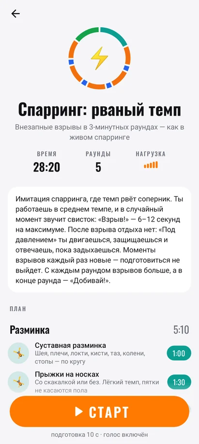
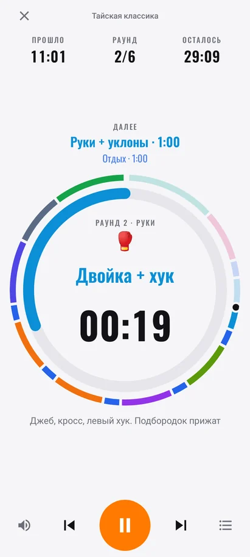
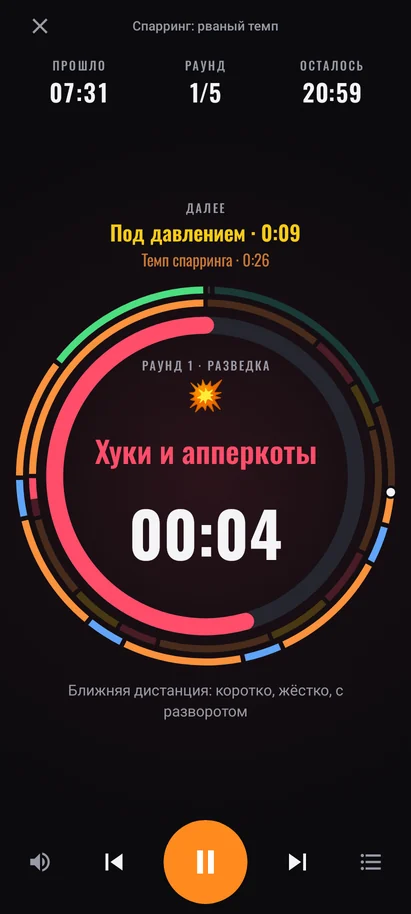

# thaimer 😎

Таймер для тренировок по тайскому боксу дома — на дни, когда не получается доехать до зала.
Android-приложение: 11 готовых тренировок, гонг и голос тренера на русском, кольца прогресса как в interval-таймерах, заставка с огнём по мотивам логотипа зала «Чемпион».

<p>
  
  
  
  
  
</p>

## Установка на телефон

1. Скачай [`apk/thaimer.apk`](apk/thaimer.apk) (на телефоне: открой файл на GitHub → «Download raw file»).
2. Открой скачанный файл. Android попросит разрешить установку из этого источника — разреши.
3. На первом старте тренировки приложение попросит разрешение на уведомления: это управление таймером с экрана блокировки.

Нужен Android 8.0+. Новые сборки ставятся поверх старой, история тренировок сохраняется.

## Тренировки

**Дыхалка · через не могу**

| | Тренировка | Время | Раунды | Суть |
|---|---|---|---|---|
| ⚡ | **Спарринг: рваный темп** | 30 мин | 5 | Работаешь в темпе, а в случайный момент — свисток и «Взрыв!» на 6–12 с. После него отдыха нет: «Под давлением». С каждым раундом взрывов больше, в конце — «Добивай!». Отдых 45 с, каждый раз раскладка новая |
| 🥵 | **Третья минута** | 34 мин | 5 | Турник + кислородный долг: подтягивания, бёрпи, бой с тенью на задержках дыхания, взрыв и снова турник, когда руки не держат. Отдых 45 с только носом. Нужен турник |
| 😤 | Через не могу | 32 мин | 5 | Раунд начинается с 40 с работы на износ, дальше техника и два взрыва. Отдых 30 с только носом |
| 🪜 | Лестница боли | 32 мин | 2 | Взрыв в начале каждой минуты: 10 → 50 → 10 с, остаток минуты — восстановление с закрытым ртом |
| 💪 | Тайский лагерь | 36 мин | 5 | Скакалка и 5 кругов ОФП по 3 минуты без единой паузы, отдых 45 с носом, в конце минута бёрпи на количество |

**Бой и техника**

| | Тренировка | Время | Раунды | Суть |
|---|---|---|---|---|
| 🏆 | Чемпионские раунды | 33 мин | 5 | Сценарий боя: разведка → разгон → пик и «война» со случайными взрывами → финал. Отдых 1,5 мин |
| 🥊 | Тайская классика | 40 мин | 6 | Скакалка, 5 раундов боя с тенью (руки, ноги, колени и локти, комбинации, свободный бой) и тайская ОФП |
| 🦵 | Ноги-кувалды | 37 мин | 5 | Лоу, мидл, тип, свитч, чеки и сила ног |
| 🤼 | Клинч и колени | 36 мин | 5 | Колени, локти, плиометрика, шея и корпус |
| ⏱️ | Табата бойца | 29 мин | 4 | 20 с на скорость / 10 с отдыха × 8: больше про чистую технику на скорости, чем про дыхалку |

**Лёгкий день**

| | Тренировка | Время | Раунды | Суть |
|---|---|---|---|---|
| 🧘 | Техника и восстановление | 22 мин | 3 | Медленный бой с тенью, баланс, защита и длинная растяжка |

Почти все тренировки заканчиваются тремя минутами боя с тенью на расслабоне, потом заминка. На карточках — иконки направлений: 🌬️ дыхалка, 🥊 спарринг, 🎯 техника, ⚡ скорость, 💪 сила, 🧘 восстановление.

Инвентарь не нужен, кроме турника для «Третьей минуты»: скакалку можно заменить прыжками на месте, мешок — ударами в воздух.

## Как это работает

- **Кольца.** Внешнее — вся тренировка по блокам (пройденное бледнеет, точка — где ты сейчас), толстое внутреннее — сколько осталось в текущем отрезке.
- **Тап по кругу** — пауза / продолжить. После старта и после паузы есть 2 секунды форы, чтобы добежать до снаряда (без лишних звуков, на экране отсчёт).
- **«Далее»** показывает следующие два отрезка. Кроме внезапных взрывов: там «???», а таймер считает время до гонга, чтобы момент взрыва нельзя было вычислить ни по экрану, ни по уведомлению.
- **Звуки как в зале:** гонг на старт раунда, тройной гонг в конце, хлопок за 10 секунд до конца раунда, мягкие бипы 3-2-1, свисток на взрыв. Голос называет каждое упражнение («Раунд 2. Спролы! На износ!»), а за 10 секунд до конца отдыха говорит, что дальше. Музыка из другого приложения на время подсказок приглушается.
- **Экран не гаснет.** Если заблокировать телефон, таймер, гонг и голос продолжают работать, а пауза / дальше / стоп — в уведомлении.
- **Настройки** (шестерёнка): голос, звуки, хлопок за 10 с, вибрация, подготовка перед стартом 0–20 с.

### Если нет голоса

Нужен русский голос синтеза речи: «Настройки → Система → Языки → Синтез речи → Google → Установить голосовые данные → Русский». В настройках thaimer есть подсказка, которая открывает этот экран.

## Сборка

Нужны JDK 21 и Android SDK 36.

```sh
cd android
./gradlew testDebugUnitTest   # тесты + скриншоты всех экранов в app/build/screenshots
./gradlew assembleRelease     # app/build/outputs/apk/release/app-release.apk
```

- **CI** (`.github/workflows/android.yml`) на каждый push в `android/**` гоняет тесты и собирает APK (артефакт `thaimer-apk`). На тег `v*` APK прикрепляется к GitHub Release.
- **Подпись.** `android/keystore/thaimer-sideload.jks` лежит в репозитории намеренно: любая сборка (локальная или из CI) подписана одним ключом и ставится поверх предыдущей. Ключ публичный, поэтому ставь APK только отсюда. Свой ключ — через переменные `THAIMER_KEYSTORE`, `THAIMER_KEYSTORE_PASSWORD`, `THAIMER_KEY_ALIAS`, `THAIMER_KEY_PASSWORD`.
- **Звуки** синтезированы скриптом `android/tools/gen_sounds.py` (без чужих сэмплов). Шрифт Oswald — SIL Open Font License 1.1.
- **Логотип** зала «Чемпион» на заставке — векторная трассировка фото со стены зала (`res/drawable/logo_*.xml`), огонь рисуется кодом (`ui/components/Fire.kt`).

### Где что лежит

```
android/app/src/main/java/com/kazaeza/thaimer/
  data/Workouts.kt          10 тренировок: упражнения, время, подсказки, фразы для голоса
  model/                    раскладка по времени, случайные взрывы спарринга, расписание сигналов
  engine/SessionController  часы тренировки: старт, пауза, вперёд/назад, сигналы точно по времени
  audio/CuePlayer           гонг, бипы, голос (TTS), вибрация, приглушение музыки
  service/                  работа с выключенным экраном и уведомление
  ui/                       экраны на Jetpack Compose
```

Поменять тренировку — правка в `Workouts.kt`: `s("Лоу-кики", 60, LEGS, "подсказка", say = "что сказать")`.

## Веб-прототип

В корне репозитория лежит первый прототип из Google AI Studio (React + Vite + Gemini). Запуск: `npm install`, затем ключ `GEMINI_API_KEY` в `.env.local` (файл не коммитится) и `npm run dev`.
